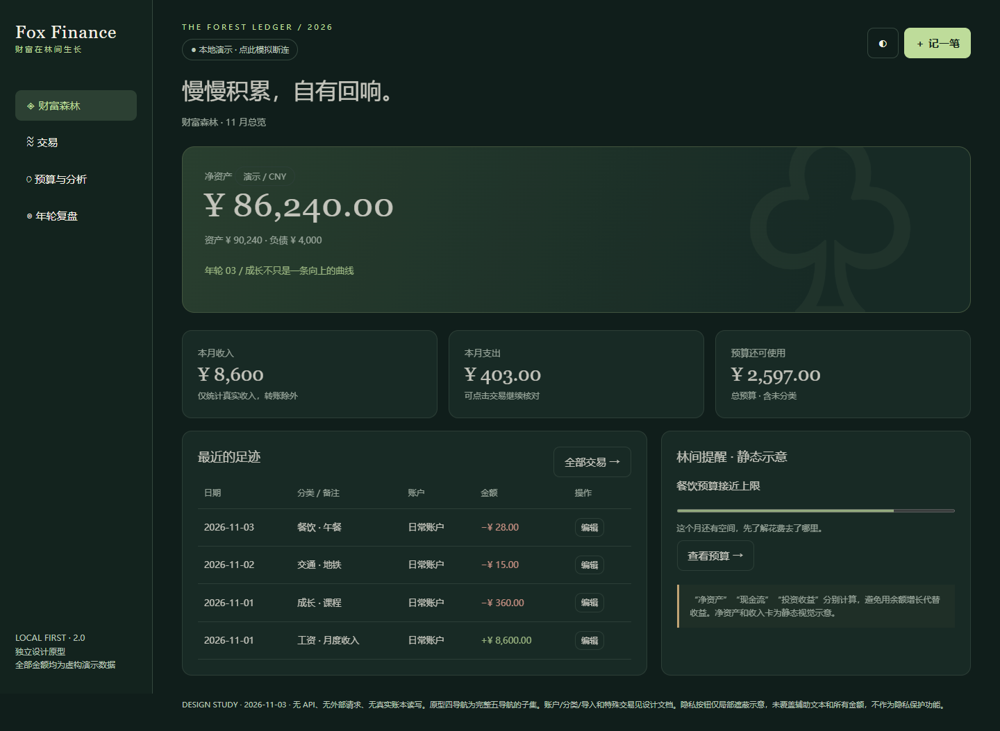

# Fox Finance 2.0 — 审计与升级规划

审计基线日期：2026-11-03；2026-11-04恢复收尾并发布本快照。当前状态为**审计与设计提案，等待用户批准**，不代表已实现集成或开始 Phase 2。

**建议先读：[完整结论与文档索引](integration/2.0-audit-2026-11-03/README.md)。**

- [技术架构与可行性](integration/2.0-audit-2026-11-03/integration-architecture.md)
- [UX/UI审计](redesign/2.0-audit-2026-11-03/ux-audit.md)
- [改版设计方案](redesign/2.0-audit-2026-11-03/ux-redesign-proposal.md)
- [实施路线图](integration/2.0-audit-2026-11-03/implementation-roadmap.md)
- [待确认决策](integration/2.0-audit-2026-11-03/decision-log.md)
- [独立交互原型说明](redesign/2.0-audit-2026-11-03/prototype/README.md)：下载本目录后用浏览器打开原型 `index.html`。GitHub 文件页不运行交互。

本目录为 Vault 项目文档的交付快照，包含用户要求的15份文档、补充报告、开源比较和隔离原型。保留原文档目录，不含账本、数据库、个人交易正文或认证令牌。原型中的金额、账户及交易均为虚构，不连接真实财务数据。

已执行验证及未测范围见[验收记录](integration/2.0-audit-2026-11-03/acceptance-tests.md)。审计交付不构成生产开发或数据迁移授权。
