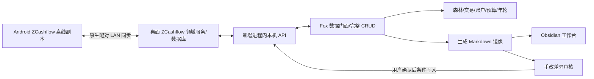

# Fox Finance 2.0 审计与升级方案

审计日期：2026-11-03。**结论：值得升级；ZCashflow 集成有条件可行，尚不具备直接切换条件。当前阶段结束于审阅，不开始 Phase 2。**

## 1. 真实完成度

Fox Finance 是已有交易CRUD、账户/分类/预算配置、森林首页、月度年轮、基础图表和工作台集成的个人 Obsidian 插件，具备继续迭代的基础。不能据现有文档勾选把它称为成熟财富管理底座，也不适合用缺乏验收基准的“完成百分比”描述。

实际安装仓库：`D:/Obsidian/OB/.obsidian/plugins/fox-finance`；文档：`D:/Obsidian/OB/99-Project/FoxFinance/docs`。Vault 为 `D:/Obsidian/OB`。manifest 0.6.1、package 0.3.0、旧实施文档头部0.5.0，存在版本漂移。内存构建与安装 main.js 字节一致，但未证明当前运行进程已加载该产物。审计起点25369c0带四文件改动；经用户后续授权，拉取上游两个README提交后，已有改动提交并推送为12b86a0。

## 2. ZCashflow可行性

已检查固定提交 `f72815344a447d9c5a35265f56a2987ab860999f`、1.8.0 的实际 Rust/TS/schema/sync 源码。具备领域 CRUD、UUID、墓碑、局域网加密同步基础；**不是现成REST服务**。定向搜索未找到本机安装或数据库，不能推断未安装，无法验证本机/Android运行版本。

推荐复用 Z 进程内领域服务新增 loopback 业务 API。Windows named pipe 是值得探针比较的更窄访问面方案。拒绝 Fox 直接打开/写同一 SQLite：加密模式可能是内存库和加密快照，还会绕过同步时钟与领域约束。

## 3. 数据结构主要风险

旧交易依赖行索引，缺稳定ID；隔离行为测试复现并发丢写、跨月编辑错账本、竖线备注错列、补录余额校准破坏顺序余额。历史余额调整与Z单锚点不等价；退款与投资收益也不能简单改成收入。相同文本记录只标候选，不能自动合并合法双笔。

Z原生同步使用整行HLC LWW，没有现成用户冲突历史。Fox API的条件写入仅保护Fox自己的过期编辑；满足本方案的手机冲突验收还需同步历史/冲突机制。该成本已经纳入可行性闸门。

## 4. UX优先级

先修指标可信度与编辑数据状态，再改外观。现金卡只取前三正余额再汇总、投资靠名称识别、历史年轮使用当前余额、同年年度缓存可能过期，均会影响判断。快速记账应金额首焦点，默认今天/最近账户，分类推荐可见且可改，备注标签折叠；阻止重复提交，保存与镜像成功分别反馈。

## 5. 新信息架构与核心交互

五主入口：**财富森林、交易、账户、预算、年轮**。分类/标签为账户下二级页；年轮含分析与月度复盘；设置只保留连接、镜像、隐私、主题等低频项。全局记一笔从任一主页面直接打开。交易独立页配单层详情/编辑抽屉；批量导入先解析预览、映射、重复建议、逐项审核再提交。月度复盘先对账，再解释收支/预算，最后保留个人文字。

保留森林/星空/年轮和本地品牌插画；数据区使用稳定实色衬底、清晰字阶和统一状态，不先换框架或引入图表库。[完整设计方案](../../redesign/2.0-audit-2026-11-03/ux-redesign-proposal.md)。

## 6. 推荐架构

Android离线仍由Z管理；Fox失联进入旧数据标记与草稿模式，不创建另一个可自动回写的账本。手机重连后的原生合并必须使本机变更版本变化，Fox聚焦刷新或轻量轮询后更新投影。Markdown使用稳定ID、生成基线哈希与三方差异；手改不自动写库、删镜像不删交易；个人年轮内容与生成区分开。

## 7. 预计变更模块

Fox：finance.ts 数据门面、main.ts生命周期、记账/交易/余额/现金弹窗、森林/年轮视图、styles.css，按需新增client/mirror/reconcile三个职责模块。保留现有 `readLedger`、`calcAccountBalances` 和更新事件，优先不改工作台调用方。

Z：lib.rs服务生命周期、domain事务边界、通知、sync变更追踪/冲突保留、本机鉴权与协议模块。持久幂等/版本记录可能需要数据库迁移，属未来单独批准事项，本轮未实施。

## 8. 顺序与风险

Phase0审计→Phase1架构/体验评审→Phase2虚构库桥接与双设备恢复验证→Phase3数据层→Phase4分批UX→Phase5副本迁移演练/镜像→Phase6正式切换。映射和恢复标准提前设计，真实迁移不提前。单人熟悉TS/Rust的后续实施粗估26–51有效工作日，未知同步问题可能增加成本；以阶段关口而非固定日期推进。

原账本完整保留；先证明可恢复，再讨论真实迁移。对账差异、无法映射、删除复活、鉴权失败任一出现都停止切换。详见 [风险登记](risk-register.md) 与 [路线图](implementation-roadmap.md)。

## 9. 待用户确认

维护最小Z fork的接受程度；Fox断连只读+草稿；五主入口及森林视觉；镜像目标目录和明文字段；退款/投资/历史校准的映射规则。均为提案，不因提交文档而视为批准。详见 [决策记录](decision-log.md)。

## 文档索引与验证边界

- 技术：[架构审计](architecture-audit.md)、[集成架构](integration-architecture.md)、[数据映射](data-mapping.md)、[API契约提案](api-contract.md)、[迁移与恢复](migration-plan.md)、[安全审查](security-review.md)、[风险登记](risk-register.md)、[三个开源候选比较](open-source-comparison.md)。
- 设计：[UX审计](../../redesign/2.0-audit-2026-11-03/ux-audit.md)、[信息架构](../../redesign/2.0-audit-2026-11-03/information-architecture.md)、[交互流程](../../redesign/2.0-audit-2026-11-03/interaction-flows.md)、[设计系统](../../redesign/2.0-audit-2026-11-03/design-system.md)、[改版提案](../../redesign/2.0-audit-2026-11-03/ux-redesign-proposal.md)、[独立原型](../../redesign/2.0-audit-2026-11-03/prototype/index.html)。
- 管理：[实施路线图](implementation-roadmap.md)、[验收测试](acceptance-tests.md)、[决策记录](decision-log.md)。

本轮完成代码/结构审计、旧数据层隔离行为测试和独立原型交互验证。未完成生产UI实机审计、Android同步、真实数据库恢复或逐笔会计核对；tsc受现有配置阻塞未通过。所有协议/迁移和UX生产实现均待批准。

此目录是Vault项目文档原件；GitHub仓库中的 `docs/fox-finance-2.0-audit-2026-11-03/` 是本轮交付快照，不是生产迁移数据。公开快照不包含真实财务记录、金额、凭据或数据库。
